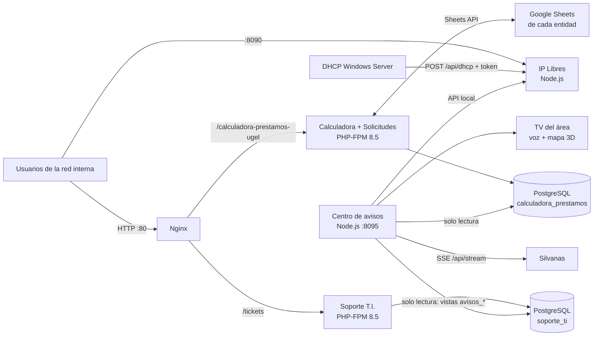

# Apps del Área de Informática · UGEL Chincha

Conjunto de aplicaciones desarrolladas por el Área de Informática de la UGEL Chincha y desplegadas **en un único servidor Ubuntu propio**, sin hosting pagado ni servicios de terceros. Este repositorio documenta cómo se conectan entre sí.

| App | Qué resuelve | Stack | Repositorio |
|---|---|---|---|
| **Soporte T.I.** | Mesa de ayuda: tickets, técnicos, inventario de equipos y fichas de mantenimiento | PHP 8.5 · PostgreSQL | [soporte-ti-ugel](https://github.com/henrycalbohorj-dot/soporte-ti-ugel) |
| **Calculadora de crédito + Solicitudes** | Evalúa la capacidad de endeudamiento (tope 50 % del neto) y recibe solicitudes de entidades financieras vía Google Sheets | PHP 8.5 · PostgreSQL · Google Sheets API | [calculadora-prestamos-ugel](https://github.com/henrycalbohorj-dot/calculadora-prestamos-ugel) |
| **IP Libres** | Escaneo de red, inventario de IPs/equipos, integración DHCP y mapa 3D del edificio | Node.js | [ip-libres-ugel](https://github.com/henrycalbohorj-dot/ip-libres-ugel) |
| **Centro de avisos** | Anuncia por voz en una TV lo que pasa en las demás apps; alimenta al asistente Silvanas | Node.js · edge-tts | [centro-avisos-ugel](https://github.com/henrycalbohorj-dot/centro-avisos-ugel) |

## Arquitectura



## Principios del despliegue

- **Un servidor, cero costo:** Ubuntu + Nginx + PHP-FPM + PostgreSQL + Node.js; cada servicio Node corre con su propio usuario de sistema y `systemd`.
- **Mínimo privilegio:** el Centro de avisos usa un rol PostgreSQL que solo ve dos vistas sin datos personales; IP Libres corre sin root (solo `CAP_NET_RAW` para ping).
- **Credenciales fuera del código:** las apps PHP leen la conexión desde variables de entorno (`fastcgi_param`); las Node desde un `config.json` local que no se versiona.
- **Acceso remoto** de administración por VPN (Tailscale), sin abrir puertos en el router institucional.

## Ejemplo de configuración Nginx

```nginx
server {
    listen 80 default_server;
    root /var/www/html;
    index index.html index.php;
    server_name _;

    include snippets/tickets.conf;          # ver README de soporte-ti-ugel
    include snippets/calculadora-ugel.conf; # ver README de calculadora-prestamos-ugel

    location / { try_files $uri $uri/ =404; }
}
```

## Qué no está en estos repositorios

Por seguridad y protección de datos personales **no se publican**: contraseñas y claves, la cuenta de servicio de Google, los datos de las bases (solo su estructura), el inventario real de la red ni configuraciones con direcciones internas. Cada repo trae archivos `*.example` para replicar la instalación.

---
Desarrollado por **Henry Braulio Pachas Dávalos** · Área de Informática, UGEL Chincha · 2026
